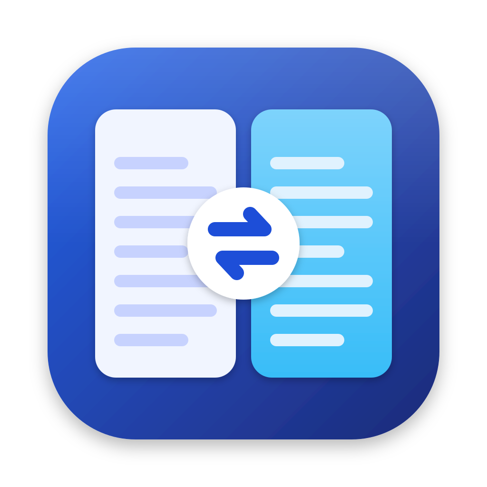

# MacSCP

A native macOS SFTP, SCP, FTP, WebDAV and Amazon S3 client with a dual-pane Commander window, based on [WinSCP](https://winscp.net).

[](https://github.com/tomaszkubiak-courses/macscp/actions/workflows/ci.yml)
[](https://github.com/tomaszkubiak-courses/macscp/releases/latest)
[](LICENSE)

MacSCP brings WinSCP's way of working to the Mac: local files on the left, the server on the right, a transfer queue below. It is written in Swift with AppKit and SwiftUI, on top of [libssh](https://www.libssh.org) and [libcurl](https://curl.se/libcurl/).

> **Status: beta.** Version 0.4.8 is translated into Polish, German, French and Spanish. Version 0.4.7 added WebDAV, WinSCP site import, PuTTY keys, a built-in editor, Find Files, a console with custom commands, and proxies. Please [report problems](https://github.com/tomaszkubiak-courses/macscp/issues).

## Features

- **SFTP and SCP**, including SCP to servers with a BusyBox or BSD userland.
- **FTP and FTPS** with explicit or implicit TLS. Untrusted server certificates are shown before connecting and can be trusted once or saved.
- **Amazon S3** and S3-compatible storage (MinIO, Cloudflare R2, Backblaze B2, Wasabi and others):
  - Buckets and folders, uploads of any size (large files go up in parts), rename and delete of whole folders.
  - Access keys from the Login window, or from `~/.aws/credentials` and the usual `AWS_*` environment variables.
- **WebDAV** over HTTPS or HTTP, with Basic or Digest login.
- **Proxies:** SOCKS5 or HTTP, with an optional login, for every protocol. FTP also offers active mode.
- **Coming from WinSCP:** import your sites (with folders and saved passwords) from a `WinSCP.ini` or `.reg` export, and use PuTTY `.ppk` keys as they are.
- **Logins:**
  - Password, keyboard-interactive (one-time codes), private keys (with passphrase), ssh-agent and Kerberos (GSSAPI).
  - Saved passwords are kept in the macOS Keychain.
- **Your SSH setup is used as is:** `~/.ssh/config` (host aliases, users, ports, `ProxyJump`) and `~/.ssh/known_hosts`. Unknown or changed host keys are always shown before connecting.
- **Commander window:**
  - Local and remote panes, with sorting, type-to-select, hidden files and a path bar.
  - Sessions open as native window tabs.
  - Folders with 100,000 files open in about two seconds.
- **Transfers:**
  - A background queue with two parallel transfers.
  - Interrupted transfers resume, and dropped connections reconnect automatically.
  - Options: overwrite rules, preserved timestamps, permissions on upload, and WinSCP's file mask syntax (`*.txt; *.log | .git/; >1M`).
- **Safe by default:**
  - Files are written to a temporary `.filepart` file and replace the target only when complete.
  - An overwritten server file keeps its permissions.
  - Local deletions go to the Trash.
- **Editing server files:**
  - A built-in text editor with find and replace, go to line, and the file's encoding and line endings kept as they are.
  - Or any other editor: TextEdit, VS Code, BBEdit, vim. Every save is uploaded.
  - MacSCP asks before overwriting a file that changed on the server in the meantime.
- **Drag and drop:** between the panes, from Finder to upload, and to Finder to download.
- **Get Info** with permission, owner and group editing, **Quick Look** for local files, and **Open in Terminal** for an `ssh` shell in the current folder.
- **Find Files** on the server with WinSCP's file masks, and **Compare Directories** to select what differs between the panes.
- **Console and custom commands:** run shell commands in the current folder, or WinSCP-style custom commands (`tar -czvf "!?Archive name:?a.tgz!" !&`) on the selected files. On FTP, the console sends raw commands.
- **Text mode:** convert line endings for text files, automatically by file type if you like.
- **Directory synchronization:**
  - Compare and sync a local and a remote folder, in either or both directions, with a preview before anything changes.
  - Compare by time, size or checksum, or synchronize timestamps only.
  - **Keep Folders Up to Date** uploads local changes as you save them, or checks the server and downloads its changes.
- **Languages:** English, Polish, German, French and Spanish, following your macOS language settings.

## Requirements

macOS 14 Sonoma or later, on Apple silicon or Intel.

## Installation

**Download:** get the DMG from the [latest release](https://github.com/tomaszkubiak-courses/macscp/releases/latest), open it, and drag MacSCP to Applications. The app is signed and notarized by Apple.

**Homebrew:**

```sh
brew trust tomaszkubiak-courses/macscp
brew install --cask tomaszkubiak-courses/macscp/macscp
```

Homebrew requires `brew trust` once for any third-party tap.

**Updates:** MacSCP checks for new versions itself, and you can check any time with MacSCP › Check for Updates….

## Getting started

1. Open MacSCP. The Login window lists your saved sites.
2. Enter a host name, then click **Login**. A host alias from `~/.ssh/config` works too. User name, port and key come from your SSH configuration unless you fill them in.
   For FTP, WebDAV or Amazon S3, choose the file protocol first. For S3, enter the access key ID and secret access key; leave the host name empty for AWS, or enter your provider's endpoint.
3. Browse with the two panes. To transfer, select files and press ⌘K, or drag them to the other pane.

To edit a server file, select it and press ⌘E: it opens in MacSCP's editor. **Files › Edit With…** picks another app, and MacSCP remembers the choice for that file type; **Edit in MacSCP** (⌃⌘E) switches back.

To bring your WinSCP sites over, export them in WinSCP (Tools › Export/Backup Configuration), then click **Import from WinSCP…** in the Login window.

## Keyboard shortcuts

| Action | Shortcut |
| --- | --- |
| New session | ⌘N |
| Open folder or file | Return, ⌘↓ |
| Enclosing folder | Backspace, ⌘↑ |
| Back / Forward | ⌘[ / ⌘] |
| Go to folder | ⇧⌘G |
| Switch pane | Tab |
| Copy to other pane | ⌘K |
| Edit / Edit With… / Edit in MacSCP | ⌘E / ⌥⌘E / ⌃⌘E |
| Rename | ⇧⌘R |
| Delete | ⌘⌫ |
| New folder | ⇧⌘N |
| Get Info | ⌘I |
| Quick Look (local) | Space |
| Show hidden files | ⇧⌘. |
| Refresh | ⌘R |
| Show queue | ⌥⌘Q |
| Synchronize | ⇧⌘S |
| Keep folders up to date | ⇧⌘U |
| Compare directories | ⇧⌘C |
| Find files | ⇧⌘F |
| Console | ⌥⌘T |
| Editor: save / find / go to line / wrap lines | ⌘S / ⌘F / ⌘L / ⌥⌘W |
| Edited files | ⇧⌘E |
| Open in Terminal | ⇧⌘T |

Coming from WinSCP? Turn on **Commander keys** in Settings for F2 (rename), F4 (edit), F5 (copy), F7 (new folder) and F8 (delete).

## Known limitations

- **S3 and WebDAV** have no permissions, links or settable file times; the time shown is the upload time. Interrupted transfers start over instead of resuming.
- **FTP** cannot create links. Servers that only list with `LIST` (for example vsftpd) give file times to the minute, so Synchronize compares them roughly.
- **The console** runs commands without a terminal, so interactive programs such as `vim` or `top` do not work. Custom commands and the console need a server that allows running commands (SFTP and SCP).
- **SSH proxies** come from the site's proxy settings or from `~/.ssh/config` (`ProxyJump`, `ProxyCommand`).
- **VoiceOver** has labels on the main controls but has not had a full review. Please report anything that does not work.

## Building from source

You need Xcode 26 or later and [Homebrew](https://brew.sh).

```sh
brew install cmake ninja xcodegen
scripts/build-cssh.sh          # builds libssh, libcurl and OpenSSL as a universal xcframework (first time only)
swift build                    # the RemoteCore engine
xcodegen                       # generates MacSCP.xcodeproj from project.yml
open MacSCP.xcodeproj          # or: xcodebuild -project MacSCP.xcodeproj -scheme MacSCP build
```

### Tests

Unit tests run with `swift test`. Integration tests need SSH, FTP, S3 and WebDAV servers and two proxies; the repository starts throwaway ones on localhost. The FTP and WebDAV servers (pyftpdlib, WsgiDAV) are installed into Python virtual environments under `build/` on first start.

```sh
brew install dropbear versitygw
scripts/test-servers.sh start  # OpenSSH :2222, Dropbear :2223, FTP/FTPS :2121, S3 :9000/:9001, WebDAV :8080/:8443, proxies :1080/:3128
MACSCP_INTEGRATION=1 swift test
scripts/test-servers.sh stop
```

CI runs the integration suite against:
- OpenSSH, Dropbear, pyftpdlib (FTP and FTPS), versitygw (S3) and WsgiDAV (WebDAV), over HTTP and HTTPS where it applies, directly and through SOCKS5 and HTTP proxies, on macOS and Linux, including password logins.
- OpenSSH 7.4, a BusyBox userland, ProFTPD over SFTP, FTP, and explicit and implicit FTPS, vsftpd, and Apache WebDAV.

### Project layout

| Path | Contents |
| --- | --- |
| `Sources/RemoteCore` | Engine: SSH connection, SFTP, SCP, FTP/FTPS, S3 and WebDAV, proxies, transfers, queue, synchronization, remote editing, sites. Foundation only; also builds on Linux. |
| `App/Sources` | The macOS app: Commander window, panes, queue, dialogs, editor, console. |
| `App/Resources` | String Catalog with the translations, and the app icon. |
| `App/Icon` | The app icon's SVG source. |
| `Tests/RemoteCoreTests` | Unit and integration tests, with PuTTY key fixtures. |
| `scripts` | Building libssh and libcurl, test servers and proxies, benchmarks, releases. |

## Roadmap

- **Next:** getting ready for 1.0: testing against Amazon S3 and other storage providers, more FTP servers and hosting providers, and the Windows OpenSSH server, then a week of daily use.
- **1.0** follows when that is done.
- Reviews of the translations, and new languages, are welcome.

## Relationship to WinSCP

MacSCP is an independent project. It is not affiliated with or endorsed by WinSCP or its author, Martin Přikryl. WinSCP's source code serves as the reference for MacSCP's behavior. Logic ported from it (listing parser, file masks, transfer options, synchronization rules, SCP protocol handling, site import) keeps the original GPL-3 attribution. Custom commands use WinSCP's pattern syntax.

## License

MacSCP is licensed under the [GNU General Public License v3.0](LICENSE).

It includes:
- [libssh](https://www.libssh.org), LGPL-2.1
- [libcurl](https://curl.se/libcurl/), curl license (MIT-style)
- [OpenSSL](https://www.openssl.org), Apache-2.0
- [Sparkle](https://sparkle-project.org), MIT
